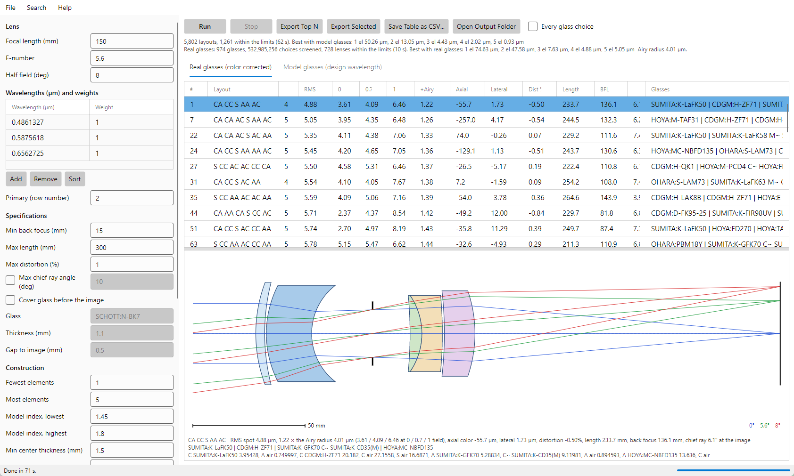

# Shafer's Simple Lens Design

Starting designs for lenses of air-spaced singlets, found in about a minute, by David Shafer's method ("Simple method
for designing lenses", Proc. SPIE 237, 1980 International Lens Design Conference).

Every surface is either **concentric about the chief ray** or **aplanatic for the marginal ray**, so every lens is free
of coma and astigmatism by construction. The app tries every layout of one to six elements with model glasses, gives
the best real catalog glasses, corrects their color with buried surfaces, and writes the lenses for OpticStudio (ZEMAX),
Code V, OSLO, Optalix, Optiland and LensHH-LT.



At 150 mm, f/5.6, ±8° and the F, d and C lines, a run of 5,802 layouts takes about 70 seconds on a 16-core PC, and the
best color-corrected lens is about 1.2 times the Airy radius.

## Install

Download the package for your system from the
[Releases page](https://github.com/jaruiz6363/ShafersSimpleLensDesign/releases). The .NET runtime is included.

| File | System |
|---|---|
| `ShafersSimpleLensDesign-Setup-<version>.exe` | Windows 10 and 11, x64: installer |
| `ShafersSimpleLensDesign-<version>-macOS-arm64.zip` | macOS 11 or later, Apple Silicon |
| `ShafersSimpleLensDesign-<version>-x86_64.AppImage` | Linux x86_64 |

The [user guide](docs/USER_GUIDE.md#1-installing-and-starting) says how to install each. Or build it from source:
see [BUILDING.md](docs/BUILDING.md).

## Use

1. Set the focal length, f-number, field and wavelengths, and the limits: back focus, length, distortion, chief ray
   angle, cover glass, and thicknesses.
2. Press **Run**.
3. Read the table: each lens's RMS spot by field and against the Airy radius, its color, distortion, length, back
   focus and chief ray angle. Click a lens to draw it.
4. Export the lenses you want, and optimize them further in your lens design program.

The same search runs from the command line, `shafer-lens`, for scripts.

## Documentation

| | |
|---|---|
| [User guide](docs/USER_GUIDE.md) | Every setting and column, a first run, exporting, tips. Also **Help > User Guide** in the app. |
| [Command line](docs/COMMAND_LINE.md) | `shafer-lens layouts` and `shafer-lens build`, every option. |
| [Method](docs/METHOD.md) | Shafer's rules, buried surfaces, the search and the color stage, what has been learned, and the checks. |
| [Building](docs/BUILDING.md) | Building from source in Visual Studio or with the .NET SDK, on Windows, macOS or Linux. |

## Building from source

```
git clone https://github.com/jaruiz6363/ShafersSimpleLensDesign.git
cd ShafersSimpleLensDesign
dotnet run --project src/ShafersSimpleLensDesign -c Release
```

Needs the .NET 8 SDK or newer, or Visual Studio 2022: open `ShafersSimpleLensDesign.sln` and press F5. See
[BUILDING.md](docs/BUILDING.md).

## License

MIT. See [LICENSE](LICENSE). Shafer's paper is cited, not included.
