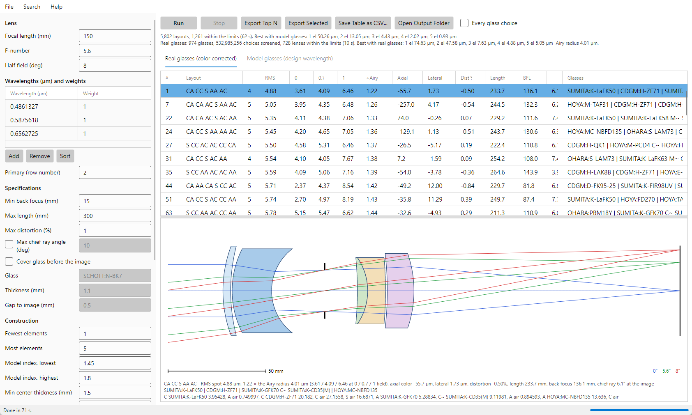

# Shafer's Simple Lens Design: user guide

Shafer's Simple Lens Design finds starting designs for lenses of air-spaced singlets in about a minute. It follows
David Shafer's "Simple method for designing lenses" (Proc. SPIE 237, 1980). Every surface is either concentric about
the chief ray or aplanatic for the marginal ray, so every lens it finds is free of coma and astigmatism by construction.
The glasses are then chosen from the vendor catalogs, and the color is corrected by buried surfaces.

You give the focal length, f-number, field and wavelengths, and the limits the lens must meet. The app tries every
layout of one to six elements, ranks the results, draws them, and writes the ones you choose as lens files for
OpticStudio (ZEMAX), Code V, OSLO, Optalix, Optiland and LensHH-LT.



How the method works is in [METHOD.md](METHOD.md). The command line is in [COMMAND_LINE.md](COMMAND_LINE.md).

---

## 1. Installing and starting

Download the package for your system from the
[Releases page](https://github.com/jaruiz6363/ShafersSimpleLensDesign/releases). Each holds the app, the command line
`shafer-lens` ([COMMAND_LINE.md](COMMAND_LINE.md)), the glass catalogs and this documentation. Nothing else needs
installing: the .NET runtime is included. To build it yourself instead, see [BUILDING.md](BUILDING.md).

### Windows 10 and 11

Run `ShafersSimpleLensDesign-Setup-<version>.exe`. The installer is not code-signed, so Windows may show "Windows
protected your PC". Click **More info**, then **Run anyway**.

- It installs for the current user, so no administrator is needed. You can choose to install for all users instead.
- Its optional tasks are a desktop icon and adding the command line, `shafer-lens.exe`, to PATH. Both are off by
  default.
- The Start menu gets the app, this user guide, the README, the glass catalogs folder and the uninstaller.

### macOS 11 or later, Apple Silicon

Unzip `ShafersSimpleLensDesign-<version>-macOS-arm64.zip` and drag `ShafersSimpleLensDesign.app` into Applications.

- **First launch:** the app is signed but not notarized by Apple, so macOS says it cannot verify the developer.
  Right-click (or Control-click) the app, choose **Open**, then **Open** again. After that a double-click is enough.
- **If macOS says the app "is damaged"**, the download was quarantined. In Terminal:
  `xattr -dr com.apple.quarantine /Applications/ShafersSimpleLensDesign.app`
- **Command line:** `/Applications/ShafersSimpleLensDesign.app/Contents/MacOS/shafer-lens`.

`README-macOS.txt` in the zip repeats these steps.

### Linux x86_64

`ShafersSimpleLensDesign-<version>-x86_64.AppImage` is the whole program in one file. Make it executable and run it:

```
chmod +x ShafersSimpleLensDesign-<version>-x86_64.AppImage
./ShafersSimpleLensDesign-<version>-x86_64.AppImage                  the app
./ShafersSimpleLensDesign-<version>-x86_64.AppImage --cli --help     the command line
```

If it says FUSE is missing, install `libfuse2` (Ubuntu 22.04: `sudo apt install libfuse2`; 24.04: `libfuse2t64`),
or run it with `--appimage-extract-and-run`.

### Starting

Start **Shafer's Simple Lens Design** from the Start menu, Applications or the AppImage. **Help > User Guide** opens
this guide.

## 2. A first run

1. Leave every setting at its default: 150 mm, f/5.6, ±8°, the F, d and C lines, one to five elements.
2. Press **Run**. The progress bar at the bottom moves as the layouts are optimized (about a minute), then as the best
   are given real glasses (about ten seconds).
3. The **Real glasses (color corrected)** tab fills, best first, and the best lens is drawn below the table.
4. Click any row to draw that lens and show its prescription under the drawing.
5. Select the rows you want and press **Export Selected**, or press **Export Top N**. Each lens is written to its own
   folder under the output folder. **Open Output Folder** shows them.
6. Open the `.zmx` file in OpticStudio, or the file for your program, and go on from there.

With the defaults, the best lens is about 5 µm RMS against an Airy radius of 4 µm: a good starting point for
optimization in your lens design program, not a finished lens.

## 3. The settings

Lengths are in millimeters and angles in degrees. Hover over a field to see what it does.

### Lens

| Field | Default | Meaning |
|---|---|---|
| Focal length (mm) | 150 | The effective focal length. Every lens is scaled to it. |
| F-number | 5.6 | The image-space f-number, set by the stop. |
| Half field (deg) | 8 | The half field angle. Spots are judged at 0, 0.7 and 1 of it. |

### Wavelengths and weights

The table works as in MonoSearch. **Add** puts in a row, **Remove** takes out the selected one, and **Sort** orders them by
wavelength. Each row has a wavelength in micrometers and a weight.

- **Primary (row number)** is the design wavelength. The layouts are found at it with model glasses, the focal length
  is set at it, and the Airy radius is computed at it.
- Color is corrected over all the wavelengths. The spot is weighted by each wavelength's weight.
- **One wavelength** is allowed. Then there is no color to correct: each element takes the single real glass nearest
  its model index, with no buried surfaces, and the Axial and Lateral columns read 0.

### Specifications

| Field | Default | Meaning |
|---|---|---|
| Min back focus (mm) | 15 | The least air path from the last lens vertex to the image. A cover glass's thickness is not counted. |
| Max length (mm) | 300 | The greatest length from the first vertex to the image. |
| Max distortion (%) | 1 | At full field: the real chief ray's height against f·tan(field). |
| Max chief ray angle (deg) | off (10) | Image-side telecentricity: the full-field chief ray must meet the image within this angle of the axis. The sign does not matter: −3 and 3 both mean within ±3°. |
| Cover glass before the image | off | A plane window or filter in front of the sensor. |
| Glass | SCHOTT:N-BK7 | The cover glass, as CATALOG:NAME. |
| Thickness (mm) | 1.1 | Its thickness. |
| Gap to image (mm) | 0.5 | From its back face to the image. |

A tight chief ray limit costs a lot. At f/8 and ±8°, a 1° limit left 17 of 5,802 layouts within the limits, and none
of them well corrected; 3° left many more.

### Construction

| Field | Default | Meaning |
|---|---|---|
| Fewest elements, Most elements | 1, 5 | The sizes of lens tried. Every layout of air-spaced singlets is tried: 3·4^(N−1)·(N+1) for N elements, 5,802 for one to five. Six elements (21,504 more) take several minutes. At most 6. |
| Model index, lowest and highest | 1.45, 1.80 | The range of the model glasses (index only, no dispersion) the layouts are optimized with. Above about 1.85 only dense flints remain, and the color cannot be corrected. |
| Min center thickness (mm) | 1.5 | The least thickness of an element on the axis. |
| Min edge thickness (mm) | 0.75 | The least thickness of an element at its rim. |
| Min air space (mm) | 0.75 | The least air space between elements on the axis. |
| Min air edge (mm) | 0.75 | The least air space between two elements anywhere across the height they share, not only at the rim: a steep meniscus can come closest part way out. |
| Random starts per layout | 4 | Each layout is optimized from this many starting points, and the best kept. |

Each element's rim is as wide as real rays at three fields need, with 4% to spare, and every face of an element is
cut to that rim, as the drawing shows. The thickness limits are checked at those rims.

### Color

| Field | Default | Meaning |
|---|---|---|
| Real glasses, color corrected | on | Give the best layouts real glasses and correct their color. Off, only the model glasses are found. |
| Layouts to color | 50 | The best N layouts, and the best of each size, are given real glasses. More layouts take longer but can find better lenses: how sharp a layout is with model glasses does not predict how well it takes color. |
| Common glasses only | off | Only glasses their maker marks preferred, or melts most often (melt frequency 1 or 2). |
| Vendors | all five | SCHOTT, OHARA, HOYA, SUMITA and CDGM. |

### Export

| Field | Default | Meaning |
|---|---|---|
| Export top N | 3 | How many lenses **Export Top N** writes, from the top of the table shown. |
| Output folder | Documents\ShafersSimpleLensDesign\results | Where lenses are written. **...** chooses another. |

## 4. The results

### The summary

Two lines above the tables say what the run did:

- **Model glasses:** how many layouts were tried, how many came within the limits, how long it took, and the best RMS
  spot for each number of elements.
- **Real glasses:** how many catalog glasses were usable, how many choices of glasses were screened, how many lenses
  came within the limits, the best RMS spot for each number of elements, and the **Airy radius**.

### The tables

**Real glasses (color corrected)** lists the lenses with catalog glasses, best first. **Model glasses (design
wavelength)** lists the layouts as found with model glasses at the primary wavelength. Click a column header to sort.

| Column | Meaning |
|---|---|
| # | Rank, among every lens found. With "Every glass choice" off, the gaps are other glass choices for layouts already shown. |
| Layout | The elements in order, with S at the stop (see below). |
| El | Number of elements. |
| RMS | RMS spot radius at best focus, µm, over the field (and, on the real-glass tab, over the wavelengths by weight). |
| 0, 0.7, 1 | The same at the center, 0.7 and the edge of the field. |
| ÷Airy | RMS divided by the Airy radius, 1.22 λ N at the primary wavelength. Below 1, the spot is inside the Airy disk: diffraction limits the lens more than its aberrations. |
| Axial | Paraxial axial color, µm: the shortest wavelength's focus less the longest's. Negative means blue focuses nearer the lens. |
| Lateral | Paraxial lateral color, µm: at full field, the shortest wavelength's image height less the longest's. |
| Dist % | Distortion at full field. |
| Length | First vertex to image, mm. |
| BFL | Back focus, the air path from the last vertex to the image, mm. |
| CRA° | The full-field chief ray's angle at the image. Positive: going away from the axis (the exit pupil ahead of the image). Negative: toward it. |
| Glasses | Each element's glass, front to back. `A C~ B` is an element split by a buried surface into glasses A and B. |
| Indices | (Model tab) Each element's model index. |

Axial and Lateral are paraxial values. Sign conventions differ between lens design programs, and a lateral color plot
traced with real rays can show more at full field than the paraxial value.

**Every glass choice.** Each layout is tried with many choices of glasses, about 16 each. Unticked, the table shows only
the best for each layout, so each layout appears once. Ticked, it shows every choice that came within the limits (the
best 500), so you can compare alternatives for one layout.

### Reading a layout

Each element is written as two letters, its front and back surfaces:

- **C**: concentric about the chief ray. It adds no coma, astigmatism or distortion.
- **A**: aplanatic for the marginal ray. It adds no spherical aberration, coma or astigmatism.

So `CA CC S AA AC` is four elements: concentric front and aplanatic back, then concentric both sides, then the stop,
then aplanatic both sides, then aplanatic front and concentric back.

### The drawing and the prescription

The selected lens is drawn in its meridional section, with rays at 0°, 0.7 and 1 of the field through the edges and
center of the pupil, and a 50 mm scale bar. Below it are:

1. a summary of the lens: spot, Airy radius, color, distortion, length, back focus and chief ray angle;
2. its glasses;
3. its **surface order**: each surface's role, the glass after it and the thickness to the next. `C~` is a buried
   surface concentric about the chief ray (it corrects axial color), `M~` one centered on the marginal ray's axial point
   (lateral color), and `F=0` a flat surface such as a cover glass. The command line's `build` rebuilds a lens from this
   text ([COMMAND_LINE.md](COMMAND_LINE.md)).

## 5. Exporting

- **Export Top N** writes the top N lenses of the table shown. **Export Selected** writes the rows selected (Ctrl-click
  or Shift-click for several).
- Each lens goes in its own folder, named by rank and layout: `color001_CA-CC-S-AA-AC` for the real-glass tab,
  `model001_...` for the model tab.
- Each folder holds the lens in six formats: ZEMAX `.zmx`, Code V `.seq`, OSLO `.len`, Optalix `.otx`, Optiland
  `.json` and LensHH-LT `.lhlt`.
- **Save Table as CSV...** saves the table shown, every column, with each lens's surface order.

The exported lens has the radii, thicknesses and glasses found, the stop, the aperture, the fields and the wavelengths.
The radii are fixed numbers; Shafer's rules are not carried into the file.

## 6. Tips

- **Look at ÷Airy first.** A lens near 1 is a good start; above about 2, look at the drawing and the Axial and Lateral
  columns to see what is wrong.
- **Fast lenses are harder.** At f/4 the best lens with model glasses was 2.6 µm, but the best with real glasses only
  6.5 µm: the secondary spectrum of ordinary glasses is what is left. f/5.6 is the default for this reason.
- **Color more layouts** when the real-glass results disappoint: 50 is the default, 200 found nothing better at f/6.
- **Keep the model index at 1.80 or below** unless you have a reason. Higher indices give sharper model lenses that
  cannot be color corrected.
- **Stop** ends a run early. Stopped while the layouts are optimized, it keeps nothing; stopped while real glasses are
  being chosen, it keeps the model-glass table.
- **Run** clears the last results first.

## 7. Troubleshooting

| What you see | What to do |
|---|---|
| The status bar shows a message and nothing runs | A setting is out of range: the message says which. Elements must be 1 to 6. |
| "0 within the limits" | The limits are too tight together. Loosen the chief ray angle, back focus, length or distortion one at a time. |
| No real-glass lenses | Tick at least one vendor; loosen "Common glasses only"; raise "Layouts to color". |
| A drawn lens looks wrong | Export it and check it in your lens design program, and please report it with a screenshot. |
| Help > User Guide does nothing | Open `docs\USER_GUIDE.md` in the install folder with any text editor or Markdown viewer. |
